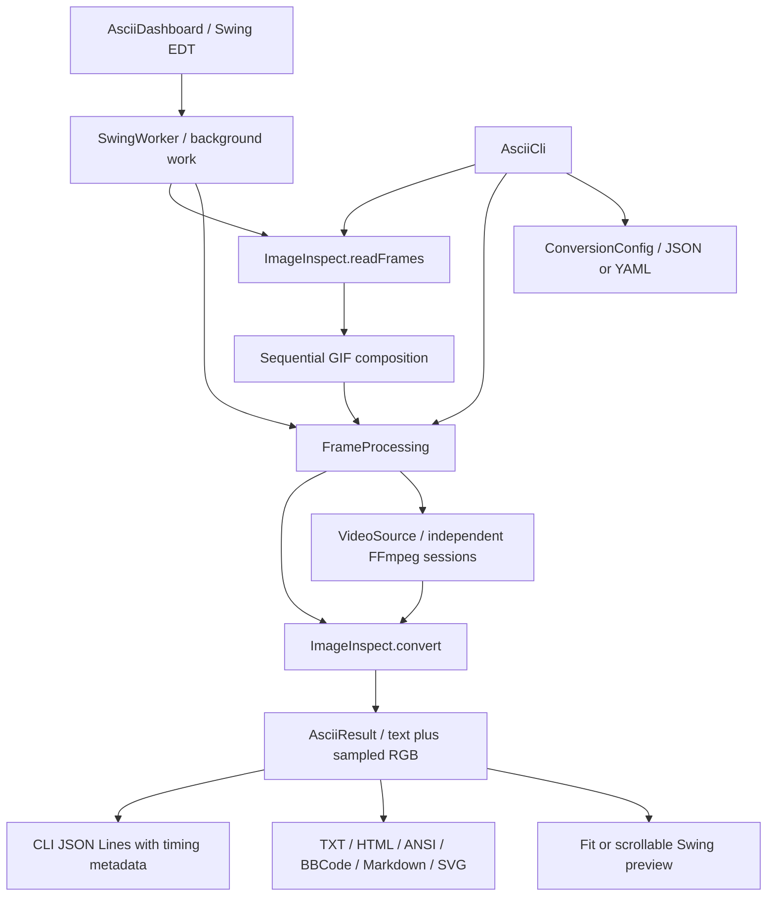

# Architecture

`ImageInspect` owns image/GIF decoding, fitting, sampling, effects, and frame
serializers. Both interfaces reuse it. `ConversionConfig` reads a flat scalar
mapping; `AsciiCli` validates the schema, applies overrides, discovers input files,
and emits deterministic output. Diagnostics use stderr; stdout carries payloads.

`AsciiDashboard` owns controls, selected media, generated previews, and metrics.
The Swing event-dispatch thread updates controls and paints. Background workers
read and convert media. `FrameProcessing` schedules bounded concurrent work with
immutable settings. Each video job forks an independent `VideoSource` session.

## Memory and lifecycle

- Still images occupy one decoded image plus conversion/output buffers.
- GIF composition is sequential because disposal can depend on earlier frames.
  Fully composed source frames remain in memory; the dashboard also retains ASCII
  results. GIF conversion is parallel, but this is not a streaming GIF reader.
- Movies use a bounded look-ahead window rather than a whole-movie cache. Capacity
  is 1–4 jobs, reduced according to estimated working-set size and maximum JVM heap.
- Settings/media changes invalidate video jobs and cached results. Closing a
  window cancels futures and shuts down its executor; each job closes its decoder.
- The dashboard stops playback, the metrics timer, active conversion, and video
  resources when disposed. Heap readings exclude FFmpeg/native memory.

## Validation boundaries

Executable tests cover conversion invariants, effects, serialization, config and
CLI behavior, GIF composition, GUI transitions, concurrency, and real MP4 decoding.
There is no external Java runtime dependency; FFmpeg/ffprobe are external tools.
The legacy `ImageInspect.main` remains the basic image/GIF launcher; use `AsciiCli`
for batch/config/video workflows. Exports are frames, not encoded movies.
