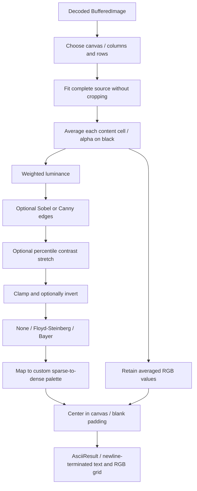

# ASCII conversion pipeline

1. `outputSize` derives text dimensions. Cells use a 1:2 width/height ratio;
   resolution names supply proportions and default character widths.
2. The full source is fitted into that canvas. Every content cell samples its source
   region; enlarged cells sample at least one source pixel. Padding is added later.
3. Alpha is composited onto black. RGB channels are averaged separately; luminance
   uses weights 0.2126 red, 0.7152 green, and 0.0722 blue.
4. Optional edges operate on the content grid. Sobel yields gradient magnitudes.
   Canny adds 3×3 smoothing, non-maximum suppression, and connected hysteresis.
5. Contrast trims the chosen fraction at either brightness extreme and stretches
   the remaining range. Near-flat ranges fall back to 0–255. Values are clamped;
   optional inversion changes character brightness, not RGB samples.
6. Quantization chooses a palette character. Floyd–Steinberg diffuses error to
   future neighboring cells; Bayer offsets thresholds with a repeating 4×4 matrix.
7. Blank padding centers the result in the target canvas. Padding never influences
   contrast or error diffusion. Exporters escape custom glyphs where necessary.

The default palette is ` .:-=+*#%@`, including its initial space. Custom palettes
accept 2–256 printable ASCII characters; glyph widths/coverage are not measured.
Color selection occurs during display/export and does not change the text grid.
