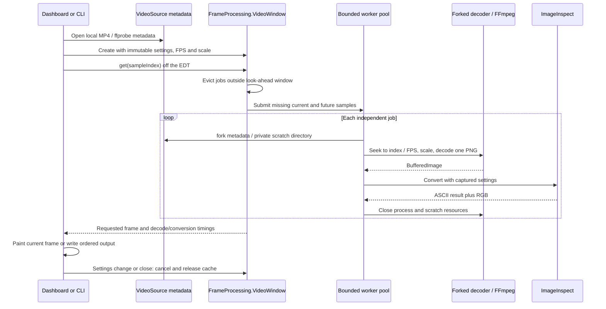

# Video decode and prefetch flow

Opening probes dimensions, duration, average FPS, and rotation metadata. The
dashboard reads an initial frame for setup, then creates a conversion window.
The CLI skips this setup preview and directly processes its sample sequence.

Each job uses its own temporary directory and subprocess; no two decoders share a
PNG output path. FFmpeg decodes a requested timestamp to scaled PNG pixels. Java
reads that image and applies the shared ASCII pipeline. The per-frame subprocess
has a 30-second timeout. Forking reuses metadata rather than running ffprobe again.

The window contains at most its capacity in scheduled/cached jobs. Worker count is
bounded by CPU count, four workers, and a memory estimate. The budget is a heuristic,
not a native-memory limit. A displayed frame and transient cancelled work can exist
outside the retained window. Requests return in requested order even if future jobs
finish first. Seeking cancels out-of-window jobs; settings changes replace the window.

Decode timing includes FFmpeg and PNG reading; conversion timing covers the shared
converter. Queue wait and metadata probing are excluded. Preview paint is timed
separately on the EDT. Playback is silent and best effort; it can be slower than
real time. Sample indices are a regular FPS timeline, not original packet indices
for variable-frame-rate video. Pause stops advancement; bounded queued work may finish.
